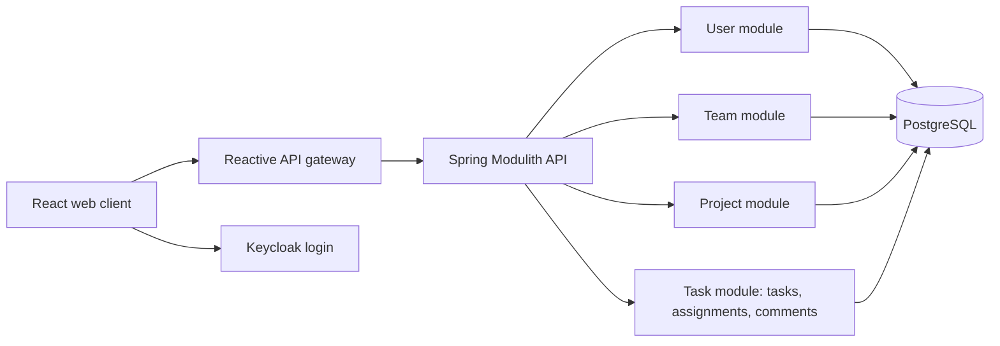

# Architecture

## Confirmed direction

A Java 21 / Spring Boot modular monolith uses Spring Modulith and Clean Architecture. A separate reactive API gateway fronts the business API. React is the web client, Keycloak owns authentication and roles, and PostgreSQL stores business data. Detailed interfaces and remaining operational choices are governed by [constraints](constraints.md).

## Stack and compatibility

| Area | Decision and rationale |
| --- | --- |
| Backend | Java 21; latest stable Spring Modulith. Verified baseline on 2026-10-29: **2.1.2**, in the Spring Boot 4.1 family. Pin compatible stable versions at implementation; do not use milestone/snapshot releases or floating production tags. |
| Gateway | Spring Cloud Gateway Server WebFlux in its own Spring Boot process. HTTP routing decouples it from the Modulith process; this is compatible without making domain/persistence code reactive. Select its Boot/Cloud versions from the official compatibility matrix. |
| Identity | Keycloak for email/password authentication and roles; API validates identity and enforces resource authorization. Realm/client names in the old API are still draft configuration. |
| Data | PostgreSQL; physical schema and persistence adapter details pending. |
| Frontend | React + React Router. Local state and optional useContext for shared state; no Flux, useReducer or Redux Toolkit. Custom CSS selected; Tailwind CSS is an allowed alternative. |
| Local runtime | Docker Compose includes web client, gateway, backend, Keycloak and database services. Add any limiter backing service only after D-12. |
| Hosting | Undecided; AWS is only a candidate. |

The official release listing reports 2.1.2 while the project landing page still displays 2.1.1; use the release listing for this baseline. Spring Boot 4.1 supports Java 21. Gateway and backend need compatible dependencies within each process, not an identical release train across both processes.

## Components and module boundaries

User owns application profiles and identity links; Team owns teams and membership; Project owns project data, ownership references and lifecycle; Task owns task data, assignments and comments. These detailed boundaries are proposed under D-01. Keep the business backend one deployable process. Module writes stay within their own ownership; cross-module reads/validation use explicit interfaces, without cycles or direct access to another module's internals.

Within each module, domain entities/rules are independent of transport and persistence frameworks. Application use cases coordinate domain logic through ports; inbound HTTP adapters and outbound database/identity adapters implement those boundaries. Dependencies point inward. Spring wiring is outside the domain; avoid a single shared domain layer that couples modules. Use Modulith verification to check module boundaries.

Spring validation handles request shape and field constraints. Domain/application logic enforces permissions, eligibility and cross-entity rules. Global backend exception handlers map errors consistently without leaking internal details; exact response schemas/status contracts remain D-01. Gateway/security errors also need consistent handling because controller handlers do not intercept all failures.

## Authentication, authorization and rate limiting

Keycloak is the only credential and role authority. Proposed browser login is OIDC authorization code with PKCE; session/token storage, logout and provisioning details require D-02/D-10 resolution. Domain records reference local profiles linked to Keycloak subjects. No independent application role field may override Keycloak roles.

The backend derives owner/author from verified authentication and checks project access for every task, assignment and comment operation. UI navigation/hidden actions are not authorization. Team membership, ownership and assignment access interactions require D-11.

Apply IP-based limiting to all endpoints, including unauthenticated traffic; do not use the gateway's default principal-name key as an IP limiter. Return HTTP 429 when the agreed quota is exceeded. Resolve client IP only through an approved trusted-proxy policy to prevent spoofed forwarding headers. Direct backend access must not bypass limiting. Identity and operational endpoints need explicit coverage in the final topology; the login arrow above represents the authentication relationship, not an approved unprotected network path.

Gateway supports pluggable rate limiters; Redis-backed limiting is an option for shared counters across replicas, not an approved new service. D-12 must settle quotas, bucket scope, backing store, failure behavior and proxy/ingress coverage. Shared NAT addresses will share the chosen IP budget.

## Frontend structure

React Router covers login, home, project list/detail and task detail navigation. Shared components include form fields, buttons, dialogs, status/priority indicators, loading/empty/error messages and reusable list elements. Keep API access/configuration centralized. Context may carry authentication/profile or other truly shared UI state; keep page/form state local where possible.

UI flows implement FR-14, update only after confirmed API results, and keep counts consistent with the authorized dataset. Assignment selectors and comment lists follow the revised model. The [revised wireframe](ui/wireframe.png) illustrates these screens and shared states; [design notes](ui/wireframe.md) explain pending behavior. No UI implementation is included here.

## Testing choices

- **Unit:** Mockito isolates backend use-case dependencies; use the Spring Boot-managed JUnit test runner. Domain validation tests need no running Spring context.
- **Integration:** Spring Boot tests plus Testcontainers for a real PostgreSQL instance managed by the test lifecycle; use service connections where supported. Spring Boot tests and Testcontainers complement each other. Docker Compose can support tests too, but isolated test containers reduce dependency on a developer's existing services/data. Docker is required.
- **Module:** Spring Modulith boundary verification and module integration tests cover approved module interfaces.
- **UI unit:** Jest for fast logic/component behavior checks.
- **Browser:** Playwright for real navigation, authentication and UI/API/persistence journeys; its browser isolation and cross-browser support suit end-to-end verification.
- Cover validation, unauthorized direct resource requests, create/read-back persistence, duplicate assignments, comments, filters/counts, error handling and IP limiting once the relevant rules are settled. Verify persistence across restarts separately from disposable test-container isolation.

These are selected approaches within the customer's permitted tools, not completed tests. No application/test commands exist yet.

## Availability and local operations

The SLA is **99.95%**, confirmed. D-08 must define how it is measured; a local Compose environment does not demonstrate production availability. Production topology must consider the gateway, backend, identity provider, database and any limiter store, with recovery and monitoring decisions under D-09. No cloud services or high-availability topology are selected yet.

Local Compose should start the full approved service set with persistent application/identity storage and reproducible fictitious demonstration data that does not erase records on startup. Keep Keycloak-managed data separate from application-owned tables; exact database/service layout is pending. Never commit real credentials. This document creates no Compose configuration or seed code.

## Sources checked on 2026-10-29

- [Spring Modulith 2.1.2 release](https://github.com/spring-projects/spring-modulith/releases/tag/2.1.2) and [release history](https://github.com/spring-projects/spring-modulith/releases).
- [Spring Boot system requirements](https://docs.spring.io/spring-boot/system-requirements.html).
- [Spring Cloud Gateway](https://spring.io/projects/spring-cloud-gateway) and [Spring Cloud compatibility](https://spring.io/projects/spring-cloud).
- [Gateway rate limiting](https://docs.spring.io/spring-cloud-gateway/reference/spring-cloud-gateway-server-webflux/gatewayfilter-factories/requestratelimiter-factory.html).
- [Spring Boot Testcontainers](https://docs.spring.io/spring-boot/reference/testing/testcontainers.html) and [Docker Compose support](https://docs.spring.io/spring-boot/reference/features/dev-services.html).
- [Jest](https://jestjs.io/docs/getting-started) and [Playwright](https://playwright.dev/docs/intro).
