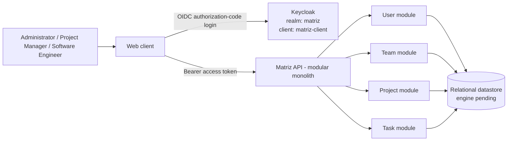

# Architecture proposal

## Decision status: proposed

Propose a **modular monolith** for the MVP. It keeps deployment and operations simple for an approximately 500-user product, while separating the main domains. Approval is pending under D-01 in the [decision register](constraints.md).

| Option               | MVP fit                                                                                              |
|----------------------|------------------------------------------------------------------------------------------------------|
| Monolith             | Simple, but risks mixing user, project, and task responsibilities.                                   |
| **Modular monolith** | **Proposed:** simple deployment with clear modules and one deployable API.                           |
| Microservices        | Adds service discovery, distributed deployment, and operational complexity not justified by the MVP. |

Docker and AWS are approved constraints. All component choices and boundaries below are proposed; the decision register governs unresolved choices.

## Components and responsibilities

- **Web client:** presents projects and project task lists; uses the API with an access token.
- **Matriz API:** enforces role permissions and exposes User, Team, Project, and Task modules.
- **Identity provider (proposed):** Keycloak realm `matriz`, client `matriz-client`; authenticates users and issues OIDC tokens.
- **Relational datastore:** persists Matriz domain data; the specific database engine is pending.

## Proposed ownership and access boundaries

- **User:** owns application profiles and identity-subject links; **Team:** owns teams and membership; **Project:** owns project details, team association, and archival; **Task:** owns task details and assignment references.
- Each module owns writes to its data. Cross-module reads and validation use explicit module interfaces; modules do not write another module's tables. Tasks obtain team information through their project.
- The identity provider owns credentials and authentication; the API validates tokens and enforces application permissions. Role authority/synchronization and Administrator provisioning remain unresolved (D-02); do not implement competing role sources.
- The draft [API contract](../openapi.yaml) and [data model](database.md) express proposals, not additional approved product rules. Their implementation depends on D-01 and the relevant product decisions.

## Deployment boundary

The proposed web client and API use Docker for AWS deployment. Platform, availability, and operations decisions are tracked under D-01, D-08, and D-09.

## Traceability and risks

The design targets FR-01 to FR-10: the identity provider supports authentication, the API enforces role access, and the modules represent projects, teams, users, and tasks. This is design intent, not verified implementation. Resolve the affected decision-register blockers before implementing each workflow; task project changes must preserve the derived team rule (FR-09).
