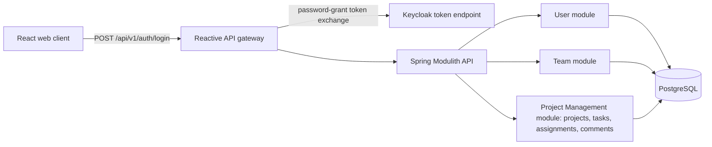

# Architecture

## Confirmed direction

A Java 21 / Spring Boot modular monolith uses Spring Modulith and Clean Architecture. A separate reactive API gateway fronts the business API. React is the web client, Keycloak owns authentication and roles, and PostgreSQL stores business data. Detailed interfaces and remaining operational choices are governed by [constraints](constraints.md).

## Stack and compatibility

| Area | Decision and rationale |
| --- | --- |
| Backend | Java 21; latest stable Spring Modulith. Verified baseline on 2026-10-29: **2.1.2**, in the Spring Boot 4.1 family. Pin compatible stable versions at implementation; do not use milestone/snapshot releases or floating production tags. |
| Gateway | Spring Cloud Gateway Server WebFlux in its own Spring Boot process. HTTP routing decouples it from the Modulith process; this is compatible without making domain/persistence code reactive. Select its Boot/Cloud versions from the official compatibility matrix. |
| Identity | Keycloak for email/password authentication and roles; API validates identity and enforces resource authorization. Realm/client names in the old API are still draft configuration. |
| Data | PostgreSQL with Flyway versioned SQL migrations; remaining physical details follow D-01. |
| Frontend | React + React Router. Local state and optional useContext for shared state; no Flux, useReducer or Redux Toolkit. Custom CSS selected; Tailwind CSS and shadcn/ui are allowed alternatives. |
| Local runtime | Docker Compose includes web client, gateway, backend, Keycloak and database services. Redis is the approved limiter and revocation-state store. Include Grafana, Loki and Prometheus for local observability. |
| Hosting | Production deferred; local Docker Compose is the current delivery target. |

The official release listing reports 2.1.2 while the project landing page still displays 2.1.1; use the release listing for this baseline. Spring Boot 4.1 supports Java 21. Gateway and backend need compatible dependencies within each process, not an identical release train across both processes.

## Components and module boundaries

User owns application profiles and identity links; Team owns teams and membership; Project Management owns projects, ownership references, tasks, assignments, comments and their lifecycle. The customer approved combining the former Project and Task modules on 2026-10-29 under D-01. Detailed interfaces remain delegated. Keep the business backend one deployable process. Module writes stay within their own ownership; cross-module reads/validation use explicit interfaces, without cycles or direct access to another module's internals.

Project Management keeps distinct internal responsibilities for projects, tasks, assignments and comments, with focused use cases and separate entities. A shared module does not make the entire project/task/comment graph one aggregate or require loading it for each request. Project deletion, project-team changes and task moves coordinate their dependent changes within this module and the required database transaction. User/team changes still coordinate assignment cleanup through explicit module interfaces; application-owned changes and cleanup must remain atomic.

This boundary reflects the limited project functionality and closely related lifecycle and eligibility rules. Expected task/comment traffic is higher than project traffic, but logical modules in this single process do not provide independent scaling or failure isolation. Approximately 500 users does not establish concurrency or prove the p95 target. Under D-08, define a representative task/comment-heavy workload, stored dataset and measurement boundary before performance acceptance; include paginated listings, filters and dashboard counts. Pagination is required for task, project, team and user listings; its API request/response contract remains delegated under D-01 and must be revised in the API baseline before implementation. The 99.95% target and deferred production decisions remain unchanged. Reconsider the boundary if projects develop substantial independent workflows or ownership needs.

Within each module, domain entities/rules are independent of transport and persistence frameworks. Application use cases coordinate domain logic through ports; inbound HTTP adapters and outbound database/identity adapters implement those boundaries. Dependencies point inward. Spring wiring is outside the domain; avoid a single shared domain layer that couples modules. Use Modulith verification to check module boundaries.

Spring validation handles request shape and field constraints. Domain/application logic enforces permissions, eligibility and cross-entity rules. Global backend exception handlers map errors consistently without leaking internal details; contract completion is delegated under D-01, retaining the existing error envelope. Gateway/security errors also need consistent handling because controller handlers do not intercept all failures.

## Authentication, authorization and rate limiting

Keycloak is the only credential and role authority. The gateway's public `POST /api/v1/auth/login` endpoint forwards credentials to Keycloak's token endpoint using the password grant and returns the token response. Its authenticated, Administrator-only `POST /api/v1/auth/register` endpoint uses a narrowly permissioned Keycloak service account to create an identity with a temporary password and assign one realm role, then calls the backend to create the linked local profile and its exactly-one team membership. Domain records reference local profiles linked to Keycloak subjects. No independent application role field may override Keycloak roles.

The backend derives owner/author from verified authentication and checks project access for every task, assignment and comment operation. UI navigation/hidden actions are not authorization. All Project Managers and Software Engineers have access to all projects. Assignment requires a Software Engineer in the project team; moving a user removes old-team assignments atomically. Administrators cannot access project/task content; they manage accounts, roles and teams.

Apply IP-based limiting to all endpoints, including unauthenticated traffic; do not use the gateway's default principal-name key as an IP limiter. Return HTTP 429 when the agreed quota is exceeded. Resolve client IP only through an approved trusted-proxy policy to prevent spoofed forwarding headers. Direct backend access must not bypass limiting. Identity and operational endpoints need explicit coverage in the final topology; the login arrow above represents the authentication relationship, not an approved unprotected network path.

Gateway supports pluggable rate limiters; Redis-backed limiting is approved at 5 requests/second per IP; limiter outage returns HTTP 429. Use a token bucket refilling five tokens/second with capacity five, one token per request, shared by IP across routes and replicas. Trust forwarded headers only from explicitly configured proxies; ignore them from other callers. Concrete proxy/ingress topology is delegated under D-12. Shared NAT addresses will share the chosen IP budget.

## Frontend structure

React Router covers login, home, project list/detail and task detail navigation. Shared components include form fields, buttons, dialogs, status/priority indicators, loading/empty/error messages and reusable list elements. Keep API access/configuration centralized. Context may carry authentication/profile or other truly shared UI state; keep page/form state local where possible.

UI flows implement FR-14, update only after confirmed API results, and keep counts consistent with the authorized dataset. Assignment selectors and comment lists follow the revised model. The [revised wireframe](ui/wireframe.png) illustrates these screens and shared states; [design notes](ui/wireframe.md) explain pending behavior. No UI implementation is included here.

## Testing choices

- **Unit:** Mockito isolates backend use-case dependencies; use the Spring Boot-managed JUnit test runner. Domain validation tests need no running Spring context.
- **Integration:** Spring Boot tests plus Testcontainers for a real PostgreSQL instance managed by the test lifecycle; use service connections where supported. Spring Boot tests and Testcontainers complement each other. Docker Compose can support tests too, but isolated test containers reduce dependency on a developer's existing services/data. Docker is required.
- **Module:** Spring Modulith boundary verification and module integration tests cover User, Team and Project Management interfaces. Cover project/task cascade deletion, project-team changes and task moves within Project Management, plus atomic assignment cleanup coordinated with User/Team workflows.
- **UI unit:** Jest for fast logic/component behavior checks.
- **Browser:** Playwright for real navigation, authentication and UI/API/persistence journeys; its browser isolation and cross-browser support suit end-to-end verification.
- Cover validation, unauthorized direct resource requests, create/read-back persistence, duplicate assignments, comments, filters/counts, error handling and IP limiting once the relevant rules are settled. Verify persistence across restarts separately from disposable test-container isolation.

These are selected approaches within the customer's permitted tools, not completed tests. No application/test commands exist yet.

## Availability and local operations

The SLA is **99.95%**, confirmed. D-08 must define how it is measured; a local Compose environment does not demonstrate production availability. Production topology must consider the gateway, backend, identity provider, database and any limiter store, with recovery and monitoring decisions under D-09. Production is explicitly deferred; cloud services, high-availability topology, SLA measurement and recovery targets will be revisited before production deployment.

Local Compose should start the full approved service set with persistent application/identity storage and reproducible fictitious demonstration data that does not erase records on startup. Keep Keycloak-managed data separate from application-owned tables; use separate application and Keycloak databases/credentials; application migrations cannot access Keycloak tables. Never commit real credentials. This document creates no Compose configuration or seed code.

## Sources checked on 2026-10-29

- [Spring Modulith 2.1.2 release](https://github.com/spring-projects/spring-modulith/releases/tag/2.1.2) and [release history](https://github.com/spring-projects/spring-modulith/releases).
- [Spring Boot system requirements](https://docs.spring.io/spring-boot/system-requirements.html).
- [Spring Cloud Gateway](https://spring.io/projects/spring-cloud-gateway) and [Spring Cloud compatibility](https://spring.io/projects/spring-cloud).
- [Gateway rate limiting](https://docs.spring.io/spring-cloud-gateway/reference/spring-cloud-gateway-server-webflux/gatewayfilter-factories/requestratelimiter-factory.html).
- [Spring Boot Testcontainers](https://docs.spring.io/spring-boot/reference/testing/testcontainers.html) and [Docker Compose support](https://docs.spring.io/spring-boot/reference/features/dev-services.html).
- [Jest](https://jestjs.io/docs/getting-started) and [Playwright](https://playwright.dev/docs/intro).

## Approved session and migration decisions

Administrators deliver temporary passwords in person. Keycloak requires password change at first login and enforces an absolute session maximum of eight hours; reauthentication is required afterward. Access tokens have a separate lifetime. The delegated settings below specify idle time, token storage and immediate logout.

Flyway is selected over Liquibase for this single-PostgreSQL application: ordered SQL scripts keep schema changes directly reviewable with minimal changelog structure. Spring Boot supports both; the current scope does not require Liquibase's alternative changelog formats.

Use versioned scripts such as `V1__initial_schema.sql` under the backend's `src/main/resources/db/migration`. Pin compatible Flyway and PostgreSQL support modules with the selected Spring Boot baseline. Apply the same migrations in local startup and PostgreSQL Testcontainers tests. Flyway is the application schema migration authority; do not combine it with automatic ORM schema updates. Never edit migrations already applied to persistent environments: add a new forward migration. Keep Keycloak's database migration lifecycle separate.

Verification must cover initialization from an empty database, upgrades retaining existing records, migration checksum validation, cascade deletion and single-assignee constraints. The backend now includes versioned migrations and PostgreSQL Testcontainers tests covering these migration checks; see matriz-backend/README.md. Business use cases remain unimplemented.

Sources: [Spring Boot database initialization](https://docs.spring.io/spring-boot/how-to/data-initialization.html), [Flyway versioned migrations](https://documentation.red-gate.com/fd/versioned-migrations-273973333.html).

## Delegated security baseline

These are selected implementation settings under the user's approval of proposal 6, not pre-existing product requirements.

- Keycloak: minimum password length 15 characters, allow passphrases, reject passwords equal to the username/email. Temporary passwords require change on first login. Enable temporary brute-force lockout after five consecutive failures, with a 15-minute lockout; verify the pinned Keycloak configuration produces this behavior.
- Absolute session maximum eight hours; idle timeout 30 minutes; access-token lifetime five minutes. Keep SPA tokens only in memory, never localStorage/sessionStorage. Use the configured Keycloak password grant and refresh-token rotation. Reload may restore login through a valid refresh token.
- Immediate API logout: validate JWT signature, issuer, audience and expiry, then check shared server-side session revocation on every authorized request at the gateway and backend. Key revocation by validated Keycloak session ID, retain it through the maximum remaining session/token lifetime and do not cache a positive authorization across requests. Reject replayed tokens from a revoked session even if their JWT expiry is in the future.
- Logout records revocation durably in Redis before reporting success, then terminates the Keycloak session. Keycloak logout failure must be reported/retried without re-enabling the locally revoked session. Redis loss or unavailability must never resurrect sessions; use persistence and fail closed, requiring reauthentication when session-state integrity is uncertain. The approved limiter outage response remains 429.
- Integrate verified Keycloak back-channel logout to revoke corresponding application access. API logout applies to the current session; changing a role invalidates all affected user's active application sessions so old permissions cannot persist. Role changes are Administrator-only, reconciled with Keycloak; enforce the current role/eligibility before subsequent mutations.
- Logout cannot undo already committed transactions. Tests must prove that requests authorized after successful logout are rejected across replicas.

Implementation scope update (2026-10-29): the user requested immediate logout invalidation in the gateway and explicitly deferred backend dependencies/enforcement for this change. Gateway login registers active session IDs in shared Redis; logout writes a revocation tombstone before the direct Keycloak logout request. Unknown session IDs fail closed, including after loss of Redis state. The current public-client password-grant integration uses Keycloak's legacy refresh-token logout request; the API accepts the current refresh token in a JSON body. Logout may be retried with a signed, unexpired access token after revocation, without restoring business access. Compose uses AOF with synchronous fsync and no eviction. Backend enforcement and provider-initiated back-channel logout remain outstanding; the original end-to-end acceptance criteria are not yet complete.
- Do not add dedicated business-audit storage. NFR-11 was revoked on 2026-10-30. Continue ordinary security and operational logging without credentials, tokens or business content, as required for diagnostics and observability; no fixed retention period is mandated for the local MVP.

## Delegated data and API completion

User, Team and Project Management modules retain the ownership described above. Project/task/comment/assignment coordination is internal to Project Management; use explicit application ports for eligibility checks and cleanup orchestration involving User and Team. Framework wiring coordinates cross-module workflows without cyclic module dependencies. Combining modules does not change the approved API routes, schemas, role permissions or logical entities. Physical schema uses PostgreSQL UUID keys, required foreign keys, case-insensitive email uniqueness and a unique task assignment. Store timestamps as instants and render the agreed server-local 24-hour format.

Provisioning reserves a unique identity/profile correlation, creates the Keycloak identity and finalizes the local profile/team link; partial states cannot log in to business operations. The gateway compensates a role/profile failure by deleting the just-created Keycloak identity and never reports success. Retry using the same correlation; reconcile incomplete records without reporting success or creating duplicate users. Keycloak role changes and local assignment cleanup use a coordinated retryable workflow because they cannot share a PostgreSQL transaction. Application-owned project/team/task moves clean up invalid assignments in the same transaction. Reject occupied-team deletion and duplicate/second assignments with 409.

## Spring Boot 4 observability and Compose topology

Both owned Java applications (gateway and backend) include `spring-boot-starter-actuator`, Micrometer and `io.micrometer:micrometer-registry-otlp`. Use the Spring Boot dependency-management baseline rather than independently selecting incompatible Micrometer versions.

Metrics flow: application Micrometer OTLP/HTTP export to Prometheus at `http://prometheus:9090/api/v1/otlp/v1/metrics`, with Prometheus's `--web.enable-otlp-receiver` enabled. Configure `management.otlp.metrics.export.url` accordingly. Grafana queries Prometheus. Loki is a log store and does not replace this metrics backend.

Logs flow: Logback through the OpenTelemetry Logback appender and OTLP HTTP exporter to Loki's native `http://loki:3100/otlp/v1/logs` endpoint. Configure `management.opentelemetry.logging.export.otlp.endpoint` and explicitly install/wire the appender to the auto-configured OpenTelemetry instance; Actuator alone does not bridge logs. Select the compatible Boot 4 OpenTelemetry support and exporter artifacts at implementation and test both gateway/backend delivery. Enable Loki structured metadata. Direct export suffices locally; no collector or trace-storage service is required by this decision.

Provide persistent local volumes for Grafana configuration, Loki logs and Prometheus metrics. Use bounded asynchronous telemetry export; telemetry failures must not block ordinary requests. Do not use email/user IDs, raw resource URLs or content as metric labels. Observe request durations/errors, JVM health, connection pools and rate-limiter outcomes. Measure p95 against the under-two-second NFR; record the measurement boundary, concurrent load and dataset before claiming performance acceptance. No dedicated business-audit store or fixed Loki retention period is required for the local MVP; metrics and future backups have separate policies.

Local network design: publish the web/gateway entry and loopback-only Grafana UI. Keep database, Redis, Keycloak administration, backend and telemetry ingestion on internal networks without direct public ports. Route public OIDC and operational/application endpoints through the IP limiter; do not expose a direct Keycloak/backend bypass. Restrict Actuator exposure to required health/diagnostic routes, with access control and limiting. Telemetry ingestion is private and authenticated/restricted to service senders. Do not add an unapproved rate-limit exception for operational endpoints. Actual production proxy allowlists follow the selected deployment.

Sources checked for this design:
- [Spring Boot 4 observability](https://docs.spring.io/spring-boot/4.0/reference/actuator/observability.html)
- [Spring Boot OTLP metrics](https://docs.spring.io/spring-boot/reference/actuator/metrics.html)
- [Spring Boot OpenTelemetry logging](https://docs.spring.io/spring-boot/reference/actuator/loggers.html)
- [Prometheus OTLP receiver](https://prometheus.io/docs/guides/opentelemetry/)
- [Loki native OTLP](https://grafana.com/docs/loki/latest/send-data/otel/)
- [Keycloak administration](https://www.keycloak.org/docs/latest/server_admin/index.html)
- [Spring Security OIDC logout](https://docs.spring.io/spring-security/reference/7.0/reactive/oauth2/login/logout.html)

These are documentation selections. Compose, dependencies, integrations and security behavior still require implementation and verification.
