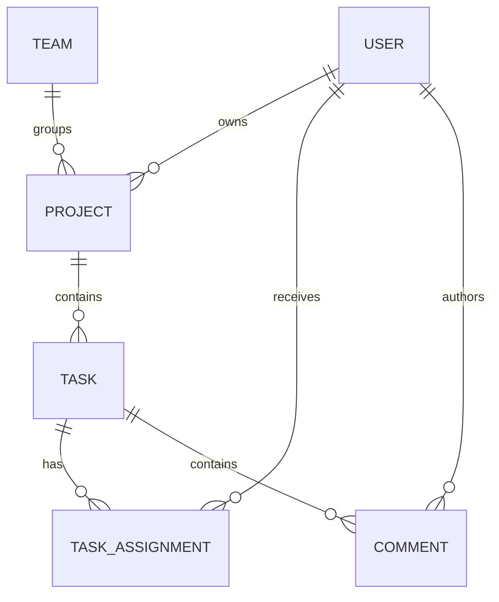

# Data model

## Status and ownership

The revised logical model reflects the customer's adoption of Practical Assignment 03. Physical types, keys and detailed contracts remain proposals under D-01. PostgreSQL is confirmed. Keycloak owns credentials and roles; application users link to its subject identifier and do not maintain an independent role authority.

| Entity | Logical attributes | Notes |
| --- | --- | --- |
| User | id, keycloakSubject, email | Local profile/reference; email uniqueness and synchronization pending D-02. No password or authoritative role column. |
| Team | id, name | Membership cardinality/lifecycle pending D-03. |
| Project | id, identifier, name, description, teamId, ownerId | Exactly one team and authenticated creator as owner. Sharing/transfer pending D-11. |
| Task | id, identifier, title, description, effort, status, priority, createdAt, updatedAt, projectId | Team derived from project. Single assigneeId removed. |
| TaskAssignment | taskId, userId | Unique pair; multiple users per task. Minimum count and eligibility pending D-05. |
| Comment | id, taskId, authorId, content, createdAt | Author and timestamp supplied by backend; no edit/delete workflow assumed. |

The diagram shows representable relationships, not a decision that tasks may be saved unassigned. Team membership is deliberately not assigned a cardinality until D-03 is resolved. Sharing is not modeled as an approved access table before D-11.

## Integrity and validation

- Unique project/task identifiers; generation/format pending D-04. Identity-subject links must identify a single local user; detailed mapping pending D-02.
- TaskAssignment uses a composite key or unique constraint on `(taskId, userId)` to prevent duplicate assignments, including concurrent requests. Assignment removal is distinct from user deletion.
- All references must resolve to existing records. Comments and assignments inherit task/project authorization; adding an assignment alone does not define access rights.
- Project name 3–100 characters, description at most 1000; task title 3–150, description at most 2000; comment content 1–2000. Reject whitespace-only required names, titles and comment content. Optionality of descriptions must be finalized in the API contract.
- Task effort: `1, 2, 3, 5, 8, 13`; status: `TODO`, `IN_PROGRESS`, `DONE`, default `TODO`; priority: `LOW`, `MEDIUM`, `HIGH`, default `MEDIUM`.
- Backend determines project owner, comment author and timestamps. Timestamp representation/timezone remains D-07.
- Deletion replaces the previous archival-only restriction. Do not select cascade deletion, soft-delete flags or retention behavior until D-06; preserve referential integrity for projects, tasks, comments and assignments.
- No stored task team, status-count entity or search entity is needed: these are derived queries over authorized data. Index selection follows the approved query contract.

## Superseded draft and migration considerations

The former single `Task.assigneeId`, independent `User.role` and project `archived` field are not the revised target model. The old task status set is superseded. If existing data is later discovered, an explicit migration and status mapping (including former QA records) is needed; this task creates no migrations. The old openapi.yaml still contains these outdated shapes and must be revised before implementation.
