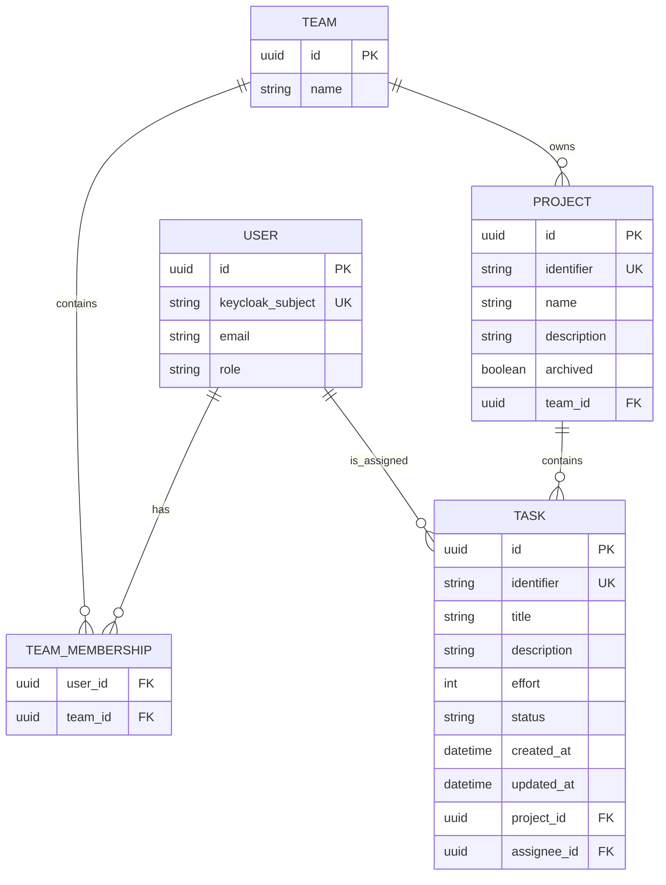

# Data model proposal

**Status: proposed.** Entity fields, types, keys, and relationships are draft design choices under D-01 in the [decision register](constraints.md). Keycloak linkage and email uniqueness depend on D-02; the diagram does not settle those decisions.

## Entities and relationships

| Entity | Essential attributes |
| --- | --- |
| User | id, keycloakSubject, email, role |
| Team | id, name |
| Project | id, identifier, name, description, teamId, archived flag |
| Task | id, identifier, title, description, effort, status, createdAt, updatedAt, projectId, assigneeId |

- A project belongs to exactly one team.
- A task belongs to exactly one project and is assigned to one Software Engineer.
- A task's displayed team is derived from its project; it is not independently maintained.
- Membership is illustrated as many-to-many for review only; see D-03 before implementing it.

## Rules represented by the model

- `Task.effort` is limited to `1, 2, 3, 5, 8, 13`.
- `Task.status` is limited to `NOT_STARTED`, `ON_GOING`, `QA`, `DONE`.
- A task assignee must be a user whose role is Software Engineer.
- Project archival is required; implementation depends on D-06.
- Identifier generation, assignment validation, and timestamps depend on D-04, D-05, and D-07 respectively.
