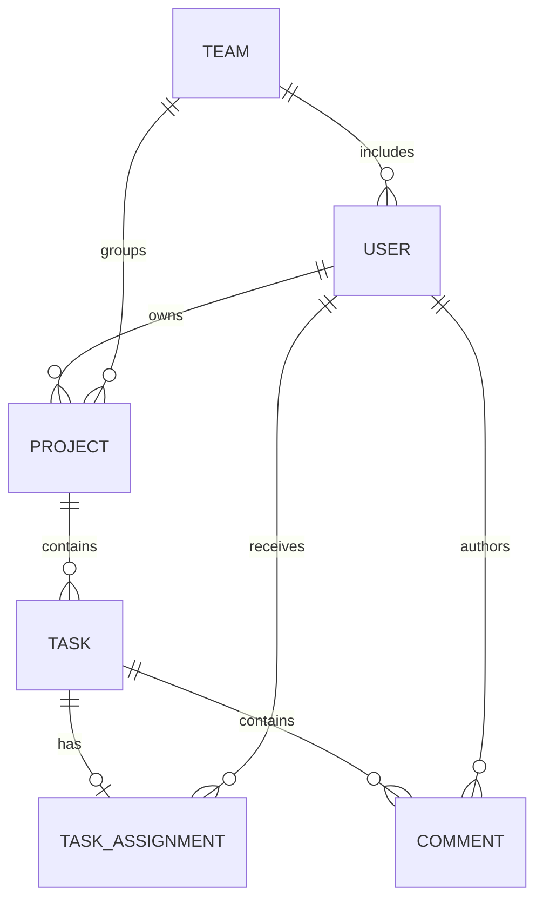

# Data model

## Status and ownership

The revised logical model reflects the customer's adoption of Practical Assignment 03. The existing schema design and API baseline are approved. Physical types and remaining implementation details are delegated under D-01. PostgreSQL is confirmed. Keycloak owns credentials and roles; application users link to its subject identifier and do not maintain an independent role authority.

The Project Management module owns Project, Task, TaskAssignment and Comment. User owns application profiles and identity links; Team owns teams and membership. Combining project and task responsibilities into one module preserves the separate logical entities and relationships below; it does not require one aggregate or loading all related records together. Cross-module eligibility checks and assignment cleanup use explicit interfaces as described in architecture.md.

| Entity | Logical attributes | Notes |
| --- | --- | --- |
| User | id, keycloakSubject, email, teamId | Local profile/reference; email is unique case-insensitively and mirrored from Keycloak. No email/profile editing in MVP. No password or authoritative role column. |
| Team | id, name | Exactly one team per user; administered by Administrators. Reject deletion while users or projects reference the team. |
| Project | id, name, description, teamId, ownerId | Exactly one team and authenticated creator as owner. All Project Managers and Software Engineers can access it; owner records the creator; no transfer workflow. |
| Task | id, title, description, effort, status, priority, createdAt, updatedAt, projectId, version | Team derived from project. Single assigneeId removed. `version` supports optimistic concurrency control. |
| TaskAssignment | taskId, userId | Unique taskId and unique task/user pair; zero or one Software Engineer per task. Assignee must belong to the project's team; user-team moves remove old-team assignments. |
| Comment | id, taskId, authorId, content, createdAt | Author and timestamp supplied by backend; no edit/delete workflow assumed. |

Tasks may be saved unassigned. Each user belongs to exactly one team. All Project Managers and Software Engineers have project access; no per-project sharing table is needed for that rule.

## Integrity and validation

- UUID project/task resource IDs only, with no separate incremental business identifiers. Identity-subject links must identify a single local user; unique Keycloak subject maps to exactly one local profile.
- TaskAssignment uses a unique constraint on `taskId` in addition to uniqueness of `(taskId, userId)` to prevent duplicate assignments, including concurrent requests. Assignment removal is distinct from user deletion.
- Task persistence uses JPA `@Version` with a non-null database version column so concurrent updates cannot silently overwrite a newer task state.
- All references must resolve to existing records. Comments and assignments inherit task/project authorization; adding an assignment alone does not define access rights.
- Project name 3–100 characters, description at most 1000; task title 3–150, description at most 2000; comment content 1–2000. Reject whitespace-only required names, titles and comment content. Descriptions are required by the approved create contract; empty descriptions are permitted.
- Task effort: `1, 2, 3, 5, 8, 13`; status: `TODO`, `IN_PROGRESS`, `DONE`, default `TODO`; priority: `LOW`, `MEDIUM`, `HIGH`, default `MEDIUM`.
- Backend determines project owner, comment author and timestamps. Render API/display timestamps in the server timezone using `dd/MM/yyyy HH:mm:ss` (24-hour clock).
- Deletion replaces the previous archival-only restriction. Physically cascade project deletion through tasks to comments/assignments, and task deletion to comments/assignment. Preserve referenced users and teams. Enforce referential integrity.
- No stored task team, status-count entity or search entity is needed: these are derived queries over authorized data. Index selection follows the approved query contract.

## Superseded draft and migration considerations

The former single `Task.assigneeId`, independent `User.role` and project `archived` field are not the revised target model. The old task status set is superseded. If existing data is later discovered, an explicit migration and status mapping (including former QA records) is needed; the initial migrations assume a new application database and do not transform a legacy schema. The approved API retains assignment endpoints/arrays with a maximum of one assignee; the latest revisions are reflected in openapi.yaml.

## Migrations

Spring Data JPA persists application-owned entities in PostgreSQL, while Flyway manages its tables with versioned SQL migrations. UUID keys remain unchanged; no project/task number sequences are needed. Use database constraints for references and single-assignee uniqueness. Team/project/task moves and invalid-assignment cleanup must complete atomically. Role-change coordination spans Keycloak and the application; use retry/reconciliation and invalidate affected sessions. Keycloak owns its schema and migrations; application Flyway scripts must not modify it. See architecture.md for migration verification and conventions.

Dedicated business audit records are out of scope following the revocation of NFR-11 on 2026-10-30. Identity provisioning still requires an explicit pending/completed state and retry correlation; only completed profiles may use business APIs. These physical details are delegated; DDL is provided by the versioned Flyway migrations in matriz-backend.

## Implemented physical schema

`V1__initial_schema.sql` creates `team`, `app_user`, `project`, `task`, `task_assignment` and `comment`. The Task table includes a non-null version column for JPA optimistic concurrency control. UUIDs are application-supplied. `app_user.team_id` is the physical membership link owned by Team workflows; Keycloak subjects and mirrored email remain User responsibilities. Email uniqueness uses a `lower(email)` index. Pending profiles reserve a unique provisioning correlation; completed profiles require a unique Keycloak subject. No passwords or authoritative roles are stored.

Task assignment uses task ID as its primary key plus explicit pair uniqueness. Project/task deletion cascades to dependent content, while user/team references restrict deletion. Text checks, effort/status/priority checks and defaults enforce the approved data constraints. Timestamps use PostgreSQL `TIMESTAMP WITH TIME ZONE`. Foreign-key/query indexes support lookups, filters and cascades; substring project-name search remains a query implementation concern.

Only `V1__initial_schema.sql` is required. The application does not use Spring Modulith's persistent event-publication registry, so no `event_publication` table is created. Dedicated audit storage is also omitted because NFR-11 was revoked.

Role/team eligibility, atomic assignment cleanup, pending-profile access checks and provisioning reconciliation remain application work. Schema constraints alone do not implement those workflows. Migration tests use isolated PostgreSQL containers; startup applies migrations only to the configured application datasource.
